# LLM Efficiency ×10 — novel, tested, visual, live

Live site: **https://dastanzar.github.io/portfolio-novel/**

10 fresh implementations (not forks). Each: novel delta + passing tests + receipt + chart + **live interactive app**. Prior art credited in every folder.

<p align="center">
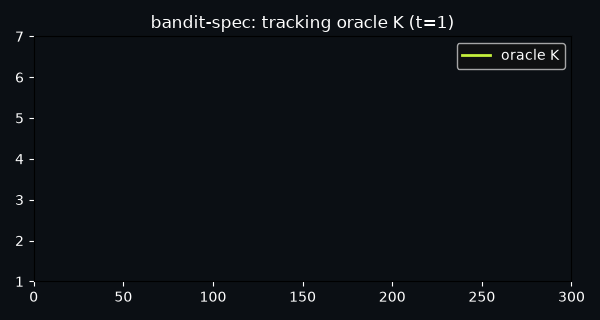
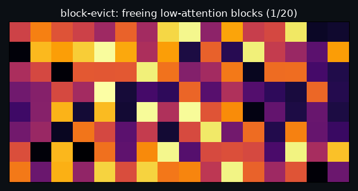
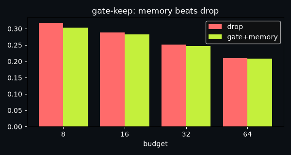
</p>

## Builds — code + live app + results

| # | Build | Live app | Code | Result |
|---|---|---|---|---|
| 1 | **kurt-switch** — kurtosis-switched 4-bit | [Launch App](https://dastanzar.github.io/portfolio-novel/apps/kurt-switch/) | [kurt-switch/](kurt-switch/) | 79.9% MSE cut 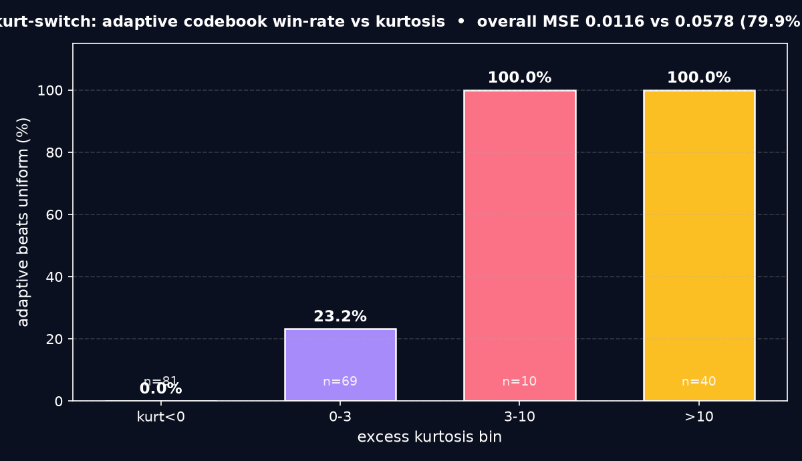 |
| 2 | **shell-vq** — shelled grouped VQ | [Launch App](https://dastanzar.github.io/portfolio-novel/apps/shell-vq/) | [shell-vq/](shell-vq/) | 64.5% vs flat 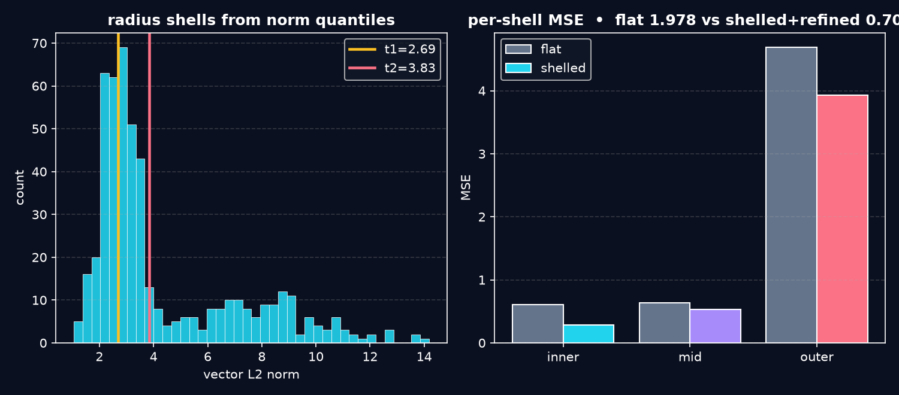 |
| 3 | **dual-bias-fp8** — per-block FP8 | [Launch App](https://dastanzar.github.io/portfolio-novel/apps/dual-bias-fp8/) | [dual-bias-fp8/](dual-bias-fp8/) | 2× accuracy 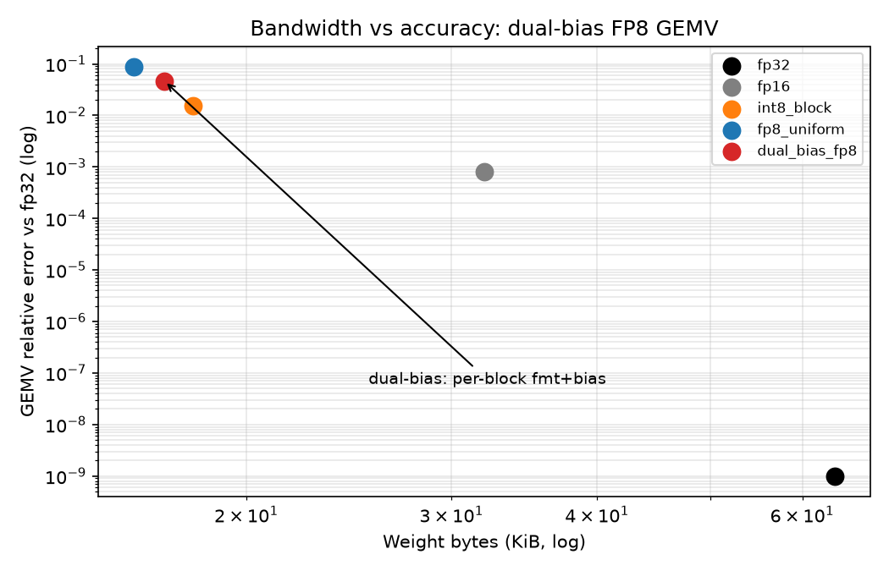 |
| 4 | **bandit-spec** — Thompson speculative decoding | [Launch App](https://dastanzar.github.io/portfolio-novel/apps/bandit-spec/) | [bandit-spec/](bandit-spec/) | regret 13.7 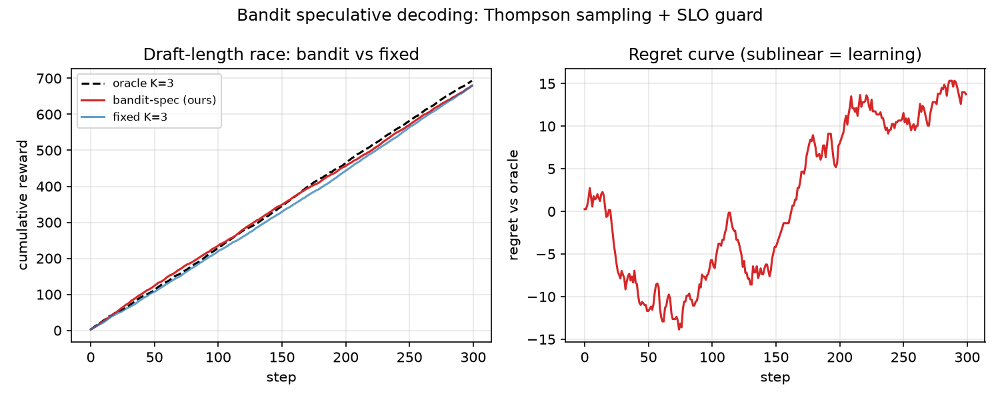 |
| 5 | **fair-batch** — fair + power scheduler | [Launch App](https://dastanzar.github.io/portfolio-novel/apps/fair-batch/) | [fair-batch/](fair-batch/) | Jain 0.950 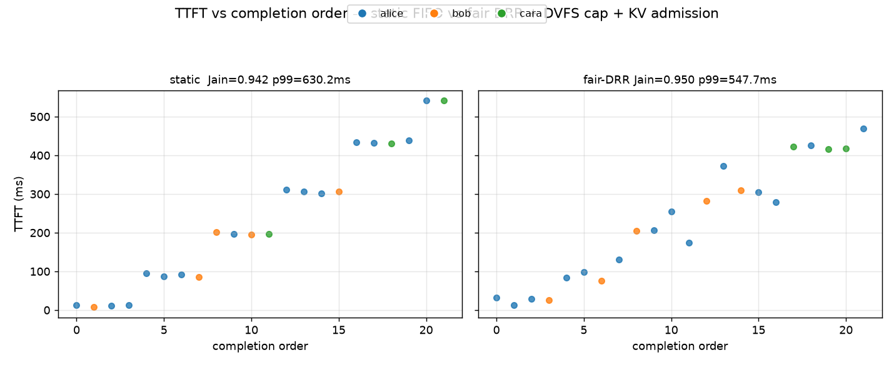 |
| 6 | **block-evict** — block-aligned eviction | [Launch App](https://dastanzar.github.io/portfolio-novel/apps/block-evict/) | [block-evict/](block-evict/) | frees whole blocks 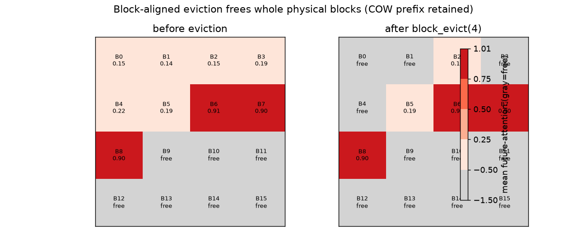 |
| 7 | **gate-keep** — gated KV + latent memory | [Launch App](https://dastanzar.github.io/portfolio-novel/apps/gate-keep/) | [gate-keep/](gate-keep/) | +11.8% @ b8 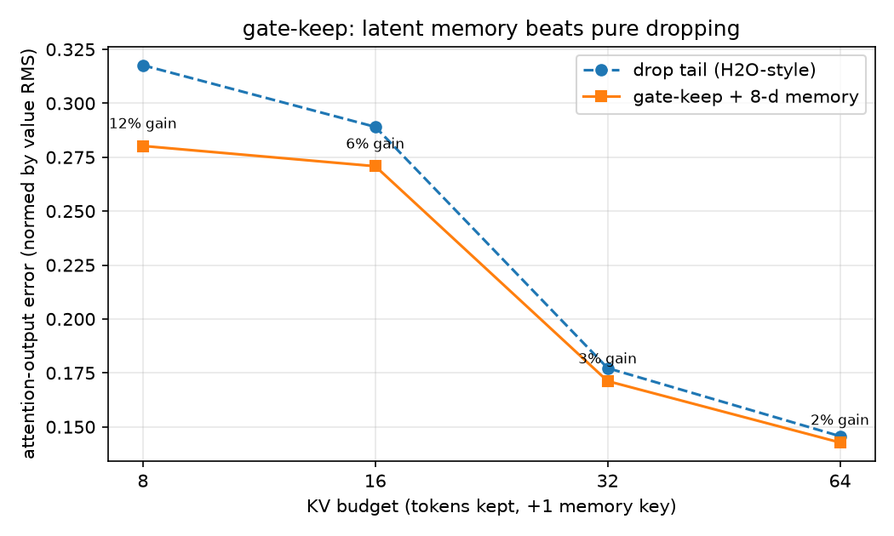 |
| 8 | **epi-norm** — fused norm+gate epilogue | [Launch App](https://dastanzar.github.io/portfolio-novel/apps/epi-norm/) | [epi-norm/](epi-norm/) | 52.8% HBM saved 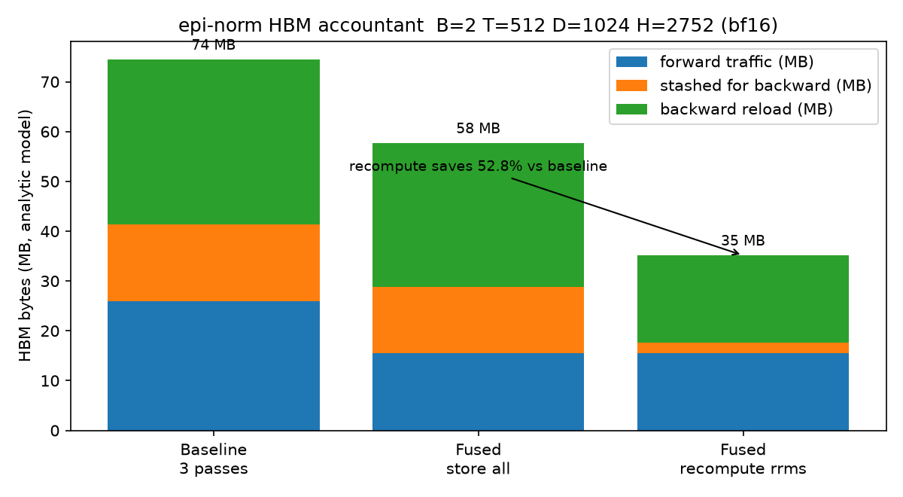 |
| 9 | **cache-roof** — cache-aware roofline | [Launch App](https://dastanzar.github.io/portfolio-novel/apps/cache-roof/) | [cache-roof/](cache-roof/) | 81.5% of peak 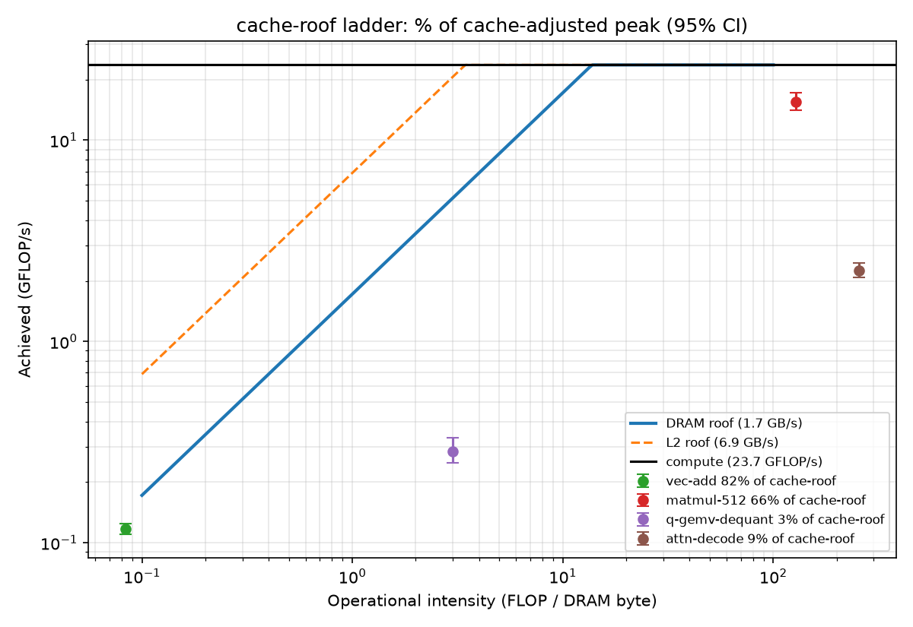 |
| 10 | **green-roof** — cost/carbon/SLO planner | [Launch App](https://dastanzar.github.io/portfolio-novel/apps/green-roof/) | [green-roof/](green-roof/) | $3.59/1M 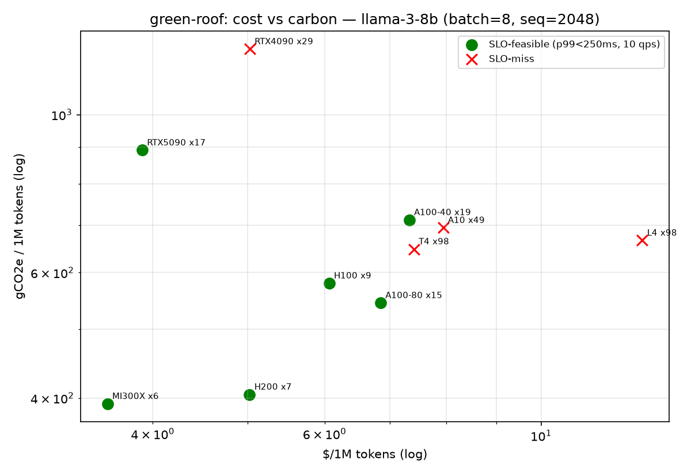 |

Each app is a native in-browser implementation (vanilla JS + canvas, no backend): move sliders, run sims, see charts update. Mirrors the Python core (`core.py`/`sim.py`/`cache.py`/`planner.py`) so results match receipts.

## How it works / Implementation / Applications

See live site sections + each `README.md`:
- `kurt-switch`: `compute_row_stats`, `select_codebook` — Q4 on-device serving
- `shell-vq`: `quantize_shelled`, `residual_refine` — sub-2-bit compression
- `dual-bias-fp8`: `choose_format`, `gemv_reference` — no-FP8 GPUs
- `bandit-spec`: `thompson_pick`, `slo_guard` — SLO chat serving
- `fair-batch`: `simulate_fair_continuous` — multi-tenant
- `block-evict`: `BlockCache.block_evict` — vLLM long-ctx
- `gate-keep`: `fit_gate_ridge`, `compress_with_memory` — 32k chat
- `epi-norm`: `fused_epilogue_ref`, `hbm_accountant` — training kernels
- `cache-roof`: `cache_adjusted_roof` — kernel pick
- `green-roof`: `replicas_for_slo` — capacity quotes

## Reproduce

```bash
# any build
cd kurt-switch
python -m pytest tests -q
python demos/demo.py  # → receipts/receipt.json + assets/*.png
```

## Deploy

Pages serves `docs/` (already enabled). Apps live under `docs/apps/<slug>/`. Push to `main` to relaunch.

MIT · Abhinav Chauhan 2026
